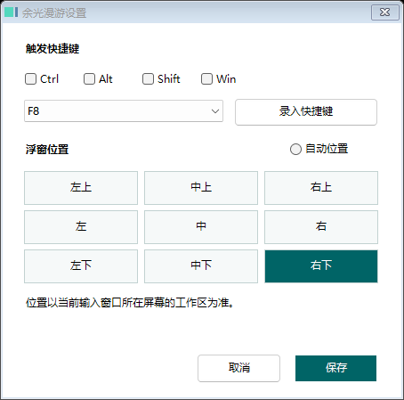

# GlanceDrift · 余光漫游

[简体中文](README.md) · English

Typing on one monitor and trying to read a tiny model number in a photo on the other? Point at the number and hold **F8**. A live close-up appears on the screen where you're typing. Scroll up to look closer, then let go and carry on. It works on a single monitor too.

[Download for Windows x64](https://github.com/mccollamspizerpmyd3191-debug/GlanceDrift/releases/latest/download/GlanceDrift-win-x64.zip) · [Release notes](https://github.com/mccollamspizerpmyd3191-debug/GlanceDrift/releases)

## Give it a try

1. Unzip the download into a folder you can write to. Keep `GlanceDrift.exe` and `PixelCapture.dll` together.
2. Run `GlanceDrift.exe`. Look for its icon in the system tray, under the little arrow if the icon is hidden.
3. Point at some small text or a detail in a photo and hold **F8**. Move the mouse around, then give the wheel a turn.

The app's menus are in Chinese. Here are the labels you'll need.

| What you want to do | How to do it |
| --- | --- |
| Follow a line of text | Hold the shortcut and move the mouse. The preview follows your pointer, even into another window. |
| Get closer or see more | Keep holding the shortcut. Scroll up to zoom in or down to zoom out, from 0.5× to 4×. |
| Get back to work | Release the shortcut. The preview disappears and the wheel scrolls the page again. |
| Pick a different shortcut | Double-click the tray icon, click **录入快捷键** (record shortcut), press a key or a combination, then click **保存** (save). |
| Get a bigger preview | Right-click the tray icon and select **加大浮窗** (larger window). Choose **清晰两倍放大** to start at 2×. |

## Put it where you want it

In automatic mode, the preview sits beside the pointer on a single screen. When you point at another monitor, the preview appears in the middle of the screen where you're typing. Prefer a fixed spot? Pick one of the nine positions in Settings. For example, **右下** keeps it in the bottom-right corner while you move the mouse.



At the default 1× zoom, the viewing area is 640 × 400 on a 1080p display and 1280 × 800 on a 4K display. Using the wheel changes the zoom inside that window.

## If something feels off

- **F8 doesn't do anything?** Hover over the tray icon to see the active shortcut. If the saved shortcut is taken at startup, the app tries F8, F9 and F10. If you try to save a shortcut that's already taken, Settings will ask you to pick another.
- **Where are my settings?** The shortcut and window position are saved in `BorrowScreen.ini`, next to the executable. BorrowScreen was the project's original name, and you'll still see it in a few filenames.

## Build it yourself

On Windows x64, install Visual Studio Build Tools with the MSVC x64 C++ toolchain and a Windows SDK that includes C++/WinRT. The build script uses the system .NET Framework C# compiler for the tray app and a C++20-capable MSVC compiler for the capture component.

Open PowerShell in the repository root and run:

```powershell
.\build.ps1
.\BorrowScreen.exe
```

A local build produces `BorrowScreen.exe` and `PixelCapture.dll`. In the downloadable ZIP, the executable is named `GlanceDrift.exe`. The tray and preview live in [BorrowScreen.cs](BorrowScreen.cs), the settings dialog in [Settings.cs](Settings.cs), and the pixel capture used for integer zoom in [PixelCapture.cpp](PixelCapture.cpp).
