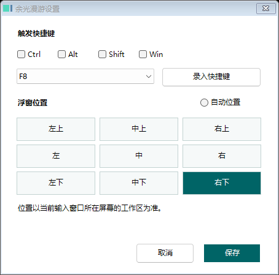

# 余光漫游 · GlanceDrift

简体中文 · [English](README.en.md)

在主屏填表，想看清副屏照片上的型号？把鼠标移到型号上，按住 **F8**，那一小块画面就会出现在你正在打字的屏幕上。滚轮向上看细节，松开 F8 就能接着填。只有一块屏幕也能用。

[下载 Windows x64 便携版](https://github.com/mccollamspizerpmyd3191-debug/GlanceDrift/releases/latest/download/GlanceDrift-win-x64.zip) · [查看版本说明](https://github.com/mccollamspizerpmyd3191-debug/GlanceDrift/releases)

## 第一次用

1. 解压下载的 ZIP，把 `GlanceDrift.exe` 和 `PixelCapture.dll` 放在同一个可写的文件夹里。
2. 双击 `GlanceDrift.exe`。图标会出现在系统托盘里，有时藏在任务栏右下角的小箭头里。
3. 找一张图或一行小字，把鼠标放上去，按住 **F8**。移动鼠标试试，再滚一下滚轮。

| 你想做什么 | 怎么操作 |
| --- | --- |
| 沿着一行字看 | 按住快捷键移动鼠标。移到另一扇窗口，预览也会跟过去 |
| 放大一点，或者多看几行 | 按住快捷键，上滚放大，下滚缩小，范围是 0.5× 到 4× |
| 收起预览 | 松开快捷键，滚轮就能继续滚页面 |
| 换个顺手的键 | 双击托盘图标，点「录入快捷键」，按下单键或组合键，然后保存 |
| 把预览放大一些 | 右键托盘图标，勾选「加大浮窗」。想一开始就看两倍大小，可以勾选「清晰两倍放大」 |

## 浮窗放哪里？

自动模式下，同屏时浮窗在鼠标旁边，跨屏时浮窗在当前输入窗口所在屏幕的中央。如果你习惯把资料放在右下角，就在设置里的九宫格点一下「右下」。这样鼠标可以到处走，浮窗一直待在那个角落。



浮窗会按屏幕大小调整。默认 1× 下，1080p 上的显示区域是 640 × 400，4K 上是 1280 × 800。滚轮只调整里面的画面，浮窗本身保持原来的大小。

## 两个小问题

- **按 F8 没反应？** 把鼠标停在托盘图标上，看看当前快捷键。启动时如果你设的键被占用，程序会尝试 F8、F9 和 F10。在设置里保存一个冲突的键时，会提示你换一个。
- **设置存在哪？** 快捷键和浮窗位置保存在程序旁边的 `BorrowScreen.ini` 里。「借屏」是这个工具最早的名字，所以部分文件沿用了 BorrowScreen。

## 想自己编译？

在 Windows x64 上安装 Visual Studio Build Tools，选上 MSVC x64 C++ 工具链和带 C++/WinRT 的 Windows SDK。脚本用系统的 .NET Framework C# 编译器构建托盘程序，用支持 C++20 的 MSVC 构建像素捕获组件。

在仓库根目录打开 PowerShell，运行：

```powershell
.\build.ps1
.\BorrowScreen.exe
```

本地构建生成 `BorrowScreen.exe` 和 `PixelCapture.dll`。发布包里主程序叫 `GlanceDrift.exe`。托盘和预览逻辑在 [BorrowScreen.cs](BorrowScreen.cs)，设置界面在 [Settings.cs](Settings.cs)，整数倍放大用到的像素捕获在 [PixelCapture.cpp](PixelCapture.cpp)。
